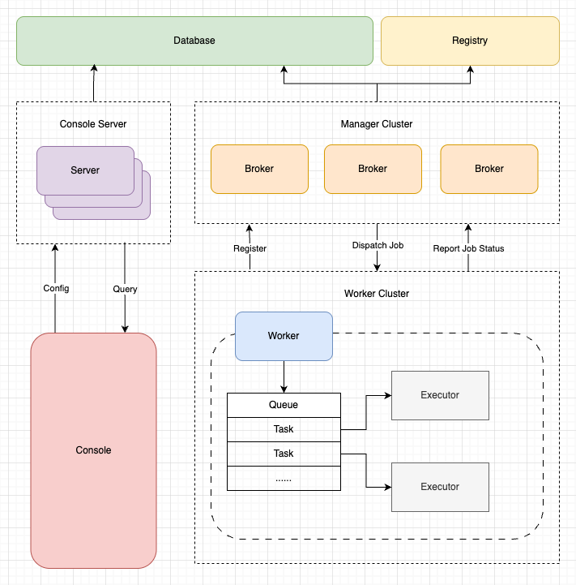

# Fluxion

[](./LICENSE)

**Fluxion** 是一个分布式任务调度平台，在 Broker 与 Worker 之间协调任务调度。项目在设计上考虑了扩展性、稳定性与伸缩性，可作为公司的任务调度中间件使用。

* Broker：管控节点，对配置好的任务在集群内调度，同时管理和维护节点注册。
* Worker：工作节点，负责 Job 的具体执行。
* Console：通过 Broker 提供的 API 进行任务创建/更新等管控操作（[官方前端项目](https://github.com/limbo-io/fluxion-console)）。
* Datasource：MySQL 作为唯一权威存储，持久化全部运行状态。

<div align="center">

</div>

## 核心概念

> 完整领域术语以 [CONTEXT.md](./CONTEXT.md) 为权威。

| 概念 | 说明 |
|------|------|
| **Trigger（触发器）** | 任务定义的触发入口；配置发布时固化版本快照 |
| **Schedule（调度）** | SCHEDULE 类型 Trigger 的时间规则（固定速率/固定延迟/CRON），维护未来触发点并产生 Execution |
| **Execution（执行实例）** | 一次计划触发的唯一持久化实例：`PENDING → CLAIMED → RUNNING → SUCCEED / FAILED / SKIPPED / MISFIRED / INVALID` |
| **Job（运行单位）** | Execution 内由 Worker 实际执行的最小单位；持有自己的派发租约、超时与重试状态 |

**投递语义**：Fluxion 保证 Execution 创建一次，但 Job 为**至少一次派发**——Worker 超时、网络响应丢失或租约恢复可能导致同一 Job 再次派发。业务执行器必须以 `jobId` 为幂等键防止外部副作用重复发生（详见[业务幂等性指南](./docs/guides/operations.md#业务幂等性指南)）。

## 功能特性

### 调度类型

* 固定速率：每隔固定时长触发一次调度。
* 固定延迟：上次执行完成后再间隔固定时长触发。
* CRON：按 CRON 表达式指定触发时间点。
* 错过触发策略（misfire policy）：到期未领取的 Execution 可按 `SKIP` 跳过或 `FIRE_RETRY` 补偿。

### 执行类型

* 执行器：执行时只创建一个 Job 实例。
* 工作流：DAG 编排，可串联多个 Job，按视图产生多个 Job 实例；支持节点失败后继续（continueOnFailure）。

### 任务类型

* 普通：对应某个执行器，执行结束任务结束。
* 广播：对每个可下发的节点下发子任务，全部完成才算完成。
* MapReduce：按 Map/Reduce 两阶段编排分布式计算。

详见 [任务类型](./docs/architecture/job-types.md)。

### 负载策略

随机、轮询、最不经常使用、最近最少使用、一致性哈希、指定节点。

### 节点过滤

执行器匹配、标签（k=v）、容量（队列/CPU/内存水位）。

## 使用帮助

### Server 部署

环境要求：**JDK 21+、MySQL 8.0+**

**Step 1：数据库配置**——使用 Flyway 自动初始化：

```yaml
spring:
  datasource:
    driver-class-name: com.mysql.cj.jdbc.Driver
    url: jdbc:mysql://127.0.0.1:3306/fluxion?useUnicode=true&characterEncoding=UTF-8&allowMultiQueries=true&serverTimezone=Asia/Shanghai
    username: root
    password: your_password
```

**Step 2：Broker 配置**

| 配置项 | 说明 |
|-------|------|
| `fluxion.broker.host` | 提供给 Worker 的服务 host。不填则自动发现本机非 127.0.0.1 的地址；多网卡场景建议显式配置 |
| `fluxion.broker.port` | RPC 端口，默认 9785 |
| `fluxion.broker.protocol` | RPC 协议，默认 http |

**Step 3：打包**（`-P` 指定 `dev`/`prod`，选择对应资源目录）：

```bash
mvn clean package -Dmaven.test.skip=true -Pdev
```

### Worker 部署

宿主应用接入参考 [Demo](https://github.com/limbo-io/fluxion/tree/master/fluxion-worker/fluxion-worker-demo)。

**Step 1：添加依赖**

```xml
<dependency>
    <groupId>io.github.limbo-io</groupId>
    <artifactId>fluxion-worker-spring-boot-starter</artifactId>
    <version>x.x.x</version>
</dependency>
```

**Step 2：配置**

| 配置项 | 说明 |
|-------|------|
| `fluxion.worker.appName` | 应用名，默认取 spring 应用名 |
| `fluxion.worker.brokers` | Broker 地址列表，可配多个 |
| `fluxion.worker.host` / `port` | Worker RPC 地址，端口默认 9787 |
| `fluxion.worker.heartbeat` | 心跳间隔，默认 3 秒 |
| `fluxion.worker.tags` | 节点标签，k=v 形式 |

```yaml
fluxion:
  worker:
    brokers:
      - http://localhost:9785
    port: 9787
    tags:
      - env=prod
      - region=cn
```

各任务执行器的使用方式参考 [Executor Demo](https://github.com/limbo-io/fluxion/tree/master/fluxion-worker/fluxion-worker-demo/src/main/java/io/fluxion/worker/demo/executor)。

## 运维与观测

详细的运维操作指南：[docs/guides/operations.md](./docs/guides/operations.md)，涵盖启动顺序、数据库迁移、Broker 故障恢复（租约接管）、故障排查命令与业务幂等性指南。

调度状态可随时通过存量观测接口获取（无需额外监控组件）：

```bash
curl -X POST http://localhost:9786/api/v1/observation/overview
# 返回 Execution/Job/Worker 各状态分布、积压、misfire 候选、可回收租约等快照
```

## 模块结构

| 模块 | 说明 |
|------|------|
| `fluxion-common` | 公共常量与工具 |
| `fluxion-remote` | Broker/Worker 通信协议（remote-core + vertx/netty 实现） |
| `fluxion-server` | Broker 端：调度、执行、状态机、容错（core + spring-boot-starter + start） |
| `fluxion-worker` | Worker 端：JobTracker、执行器框架（core + spring-boot-starter + demo） |
| `fluxion-test` | 全层级测试（单元测试 + 数据库集成 + 集群场景） |

## 开发与测试

```bash
# 单元测试（无需 Spring、数据库或 Podman）
mvn test -pl fluxion-test -am -Pregression-test

# MySQL 语义集成回归（H2 MySQL 兼容模式）
mvn test -pl fluxion-test -am -Ph2-integration-test
```

测试分层、用例清单与编写指引见 [测试指南](./docs/guides/TESTING_GUIDE.md)。

## 架构文档

详细的架构设计文档：[docs/architecture/README.md](./docs/architecture/README.md)

## 参与贡献

- 报告 issue：[github issues](https://github.com/limbo-io/fluxion/issues)
- 提交 PR：[github PR](https://github.com/limbo-io/fluxion/pulls)
- 联系我们：ysodevilo@163.com
